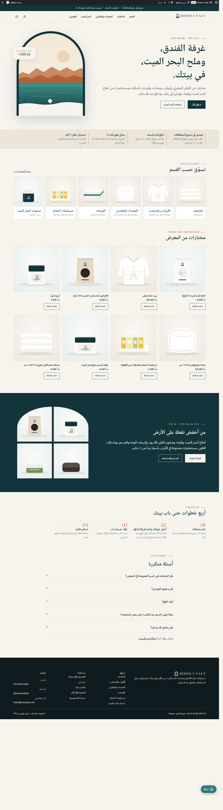

<div dir="rtl">

# Room & Salt

متجر أردني يبيع للأفراد مستلزمات غرف الفنادق ومنتجات البحر الميت: مناشف من القطن المصري، وأرواب، ومخدات وفرشات فندقية، ومستحضرات من أملاح البحر الميت وطينه. الموقع مبني على ووردبريس وWooCommerce.

**«غرفة الفندق، وملح البحر الميت، في بيتك.»**



> الاسم السابق «نُزُل» مسجّل علامةً تجارية في الأردن منذ 2007 لجهة أخرى، لذلك استُبدل بـ Room & Salt. يجب طلب بحث رسمي عن الاسم الجديد من وزارة الصناعة والتجارة قبل اعتماده.

## التحميل

| | |
|---|---|
| القالب (يُرفع على ووردبريس) | [`download/room-salt-theme.zip`](download/room-salt-theme.zip) |
| ملف الهوية (الشعارات، الخطوط، الألوان، رسومات المنتجات) | [`download/room-salt-brand-kit.zip`](download/room-salt-brand-kit.zip) |

## ما يقدّمه الموقع

- واجهة عربية بالفصحى من اليمين إلى اليسار، وتعمل على الهاتف.
- 8 أقسام و44 منتجاً بأسماء المعرض ومقاساته وأسعاره الفعلية، منها 27 منتجاً من البحر الميت.
- 3 منتجات بلا سعر ظاهر في المعرض (الشبشب، وجه المخدة السادة، طقم الشرشف) تظهر «السعر عند الطلب» مع زر واتساب.
- الدفع: نقداً عند الاستلام، أو تحويل فوري عبر CliQ. الدفع بالبطاقة يُضاف بعد موافقة شركة دفع أردنية (HyperPay أو PayTabs أو البنك).
- الشحن: عمّان 2 د.أ، وباقي المحافظات 3 د.أ، ومجاني فوق 35 د.أ (قيم مبدئية تُؤكَّد مع الإدارة).
- صفحات: التوصيل والاستبدال، من نحن، تواصل معنا، الشروط والأحكام، سياسة الخصوصية.
- زر واتساب عائم، وزر طلب عبر واتساب في صفحة كل منتج.

## الصور

الصورة الأولى لكل منتج رسم توضيحي بألوان الهوية، والصورة الثانية (في 11 منتجاً) صورة فعلية من المعرض، وصفحة المنتج تذكر ذلك. الخطوة التالية: الحصول على صور رسمية من الموردين (Rest One، Astoria، Beauty Secret) أو تصوير المنتجات على خلفية بيضاء بإضاءة النهار.

## التركيب على استضافة حقيقية

1. اشترِ استضافة تدعم WooCommerce ونطاقاً (الكلفة التقريبية: 50 – 125 دولاراً في السنة الأولى).
2. ثبّت ووردبريس، ومن الإعدادات ← عام اختر لغة الموقع: العربية.
3. الإضافات ← أضف جديد ← WooCommerce ← تثبيت وتفعيل.
4. المظهر ← قوالب ← رفع قالب ← `room-salt-theme.zip` ← تفعيل.
5. المظهر ← **إعداد المتجر**: أدخل رقم واتساب والاسم المستعار لـ CliQ، ثم اضغط «جهّز المتجر».
6. راجع صفحتي الشروط والخصوصية مع مستشار قانوني.
7. نفّذ طلباً تجريبياً من الهاتف.

## التشغيل على جهازك

```bash
bash tools/room-salt/run-local.sh
# ثم افتح http://127.0.0.1:9400
```

يحتاج Node.js 20.18 أو أحدث. ينشئ نسخة ووردبريس مؤقتة فيها WooCommerce والقالب وكل المنتجات.

## خريطة المستودع

| المسار | المحتوى |
|---|---|
| `theme/room-salt/` | القالب الحالي (المنتج الفعلي) |
| `theme/room-salt/inc/catalog.json` | قائمة الأقسام والمنتجات والأسعار، مصدر واحد للبيانات |
| `brand/room-salt/` | الشعارات، رسومات المنتجات، لقطات الشاشة |
| `tools/room-salt/` | سكربتات توليد الشعار والرسومات والصور وتشغيل الموقع محلياً |
| `theme/nuzul/`، `docs/`، `brand/` (الملفات القديمة) | نسخة «نُزُل» السابقة، محفوظة للرجوع إليها |

</div>
