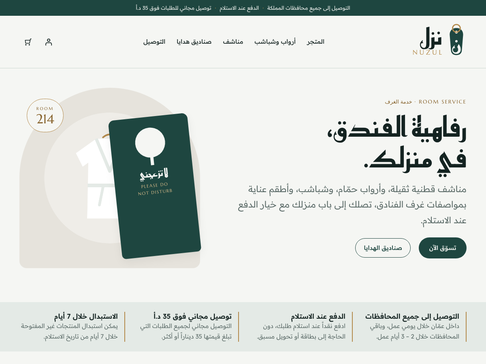

<div dir="rtl">

# نُزُل | NUZUL

متجر أونلاين بيبيع مستلزمات غرف الفنادق للأفراد بالأردن: مناشف، أرواب، شباشب، أطقم عناية، معطرات، وصناديق هدايا. الموقع مبني على ووردبريس وووكومرس، والطلب بيندفع عند الاستلام.

**«رفاهية الفندق، في منزلك.»**



## الروابط

| | |
|---|---|
| الموقع | https://ala6rash.github.io/nuzul-store/ |
| دليل الهوية وخطوات الإطلاق | https://ala6rash.github.io/nuzul-store/brand/ |
| تحميل الثيم | [`download/nuzul-theme.zip`](download/nuzul-theme.zip) |
| تحميل ملف الهوية (لوجو، خطوط، صور) | [`download/nuzul-brand-kit.zip`](download/nuzul-brand-kit.zip) |

> النسخة المنشورة على GitHub Pages ثابتة، والطلب فيها يتم من صفحة المنتج. السلة والدفع عند الاستلام يعملان بعد تركيب ووردبريس وووكومرس على استضافة.

## شو بيعمل الموقع

- واجهة عربية من اليمين للشمال، وبتشتغل على الموبايل.
- 6 أقسام و19 منتج بأسعار مقترحة بالدينار.
- الدفع عند الاستلام، والمحافظة بتنختار من قائمة، ورقم التلفون إجباري.
- الشحن: عمّان 2 د.أ، باقي المحافظات 3 د.أ، ومجاني للطلبات فوق 35 د.أ.
- زر واتساب عائم، وزر «اطلب عالواتساب» بصفحة كل منتج.
- صفحات التوصيل والاستبدال، وتواصل معنا، وصفحة «من نحن» فارغة للتعبئة لاحقاً.

## التركيب

1. اشترِ استضافة بتدعم ووكومرس ودومين.
2. نزّل ووردبريس، ومن الإعدادات ← عام اختار لغة الموقع: العربية.
3. الإضافات ← أضف جديد ← WooCommerce ← تثبيت وتفعيل.
4. المظهر ← قوالب ← رفع قالب ← `nuzul-theme.zip` ← تفعيل.
5. المظهر ← **إعداد متجر نُزُل**: حط رقم الواتساب واكبس «جهّز المتجر».
6. عدّل الأسعار من المنتجات، وبدّل الرسومات بصور حقيقية مربعة.
7. اعمل طلب تجريبي من الموبايل.

## محتويات المستودع

```
theme/nuzul/     ثيم ووردبريس (بلوكات + ووكومرس)
  inc/setup.php    صفحة "إعداد متجر نُزُل"
  inc/catalog.php  الأقسام والمنتجات والأسعار المقترحة
  patterns/        أقسام الصفحة الرئيسية والهيدر والفوتر
brand/           اللوجو والرسومات (SVG و PNG)
docs/            المعاينة الثابتة ودليل الهوية (GitHub Pages)
download/        ملفات جاهزة للتحميل
tools/           سكربتات توليد اللوجو والرسومات والمعاينة
```

الخطوط (Reem Kufi، Readex Pro، Marcellus) من Google Fonts وبرخصة SIL Open Font License.

</div>
